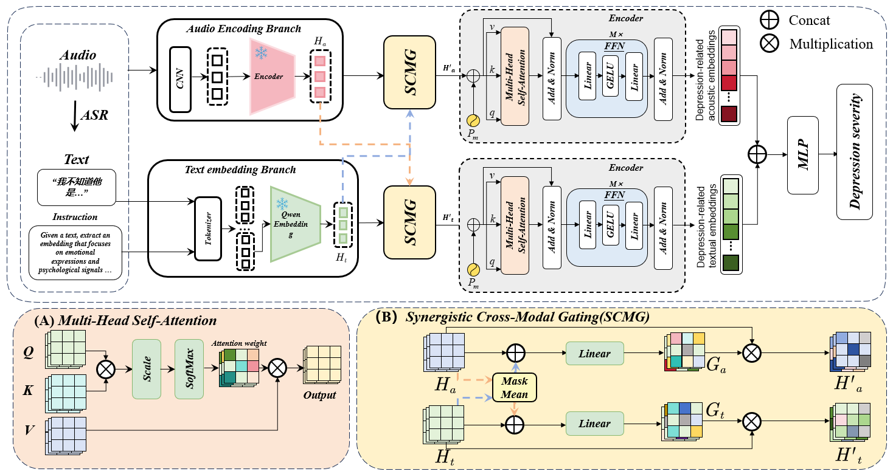
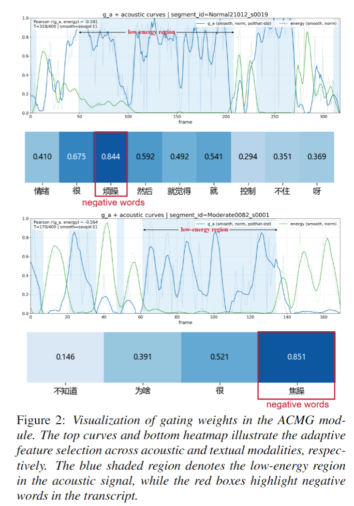

# ACMG

Source code for the audio-text baseline and the proposed cross-modal gated
model, including the three-class and DAIC-WOZ training entry points used by the
project.

## Included models

- `models.BaselineAT`: audio and text Transformer encoders followed by feature
  concatenation and classification.
- `models.ACMG`: the same backbone with token gates conditioned on the global
  context of the other modality.

The paper configuration is recorded in `config/config.yaml`. Both inputs use
shape `[batch, time, input_dim]`; padding masks use shape `[batch, time]`, where
`True` denotes padding.

## Model overview



## Gate visualization

The learned gates emphasize depression-related acoustic regions and textual
cues while suppressing less informative features.



## Data layout

Each fold CSV must contain these columns:

```text
segment_id,label,speech_label,txt_label,state
```

For the three-class experiments, `state` is `train` or `test`. For DAIC-WOZ,
`state` is `train` or `dev`, and labels are mapped to `Normal` versus
non-`Normal`. Audio and text feature directories contain one `<segment_id>.pt`
file per segment. Each file stores a dictionary with
`segment_id`, `subject_id`, and `feature`; `feature` has shape `[time, 1024]` in
the paper configuration. Dataset files and derived features are not distributed
with this repository.

## Training

`baseline.py` is the three-class training entry point. It can train either
paper model:

```bash
python baseline.py --config config/config.yaml --fold 1 --model-type A_T
python baseline.py --config config/config.yaml --fold 1 --model-type GateModel_A_T_bytime
```

Train the two-class DAIC-WOZ flow using its separate configuration:

```bash
python baseline_DAIC_WOZ.py --config config/config_DAIC.yaml --model-type A_T
```

Use `--device cuda:0` or `--device cpu` to override the configured device. Run
the three-class commands once for each prepared fold; DAIC-WOZ uses the fixed
train/dev split in `fold_1_dataset_csv`. Outputs are written below `outputs/`
and are ignored by Git.

## Development check

```bash
python -m pip install -r requirements.txt
pytest -q
```

## Release scope

This repository intentionally excludes clinical data, participant identifiers,
derived features, predictions, logs, and model checkpoints. Feature
extraction is not included yet because the exact pretrained-model revisions and
paper preprocessing settings still need to be consolidated.

The retained three-class paper flow evaluates the test split after every epoch
and uses its subject-level F1 to select the saved checkpoint. This is included
for behavioral compatibility, but it should not be presented as an unbiased
final test protocol. DAIC-WOZ uses its `dev` split for this selection. A separate
validation split is required before public release of new three-class results.

No open-source license is included yet. Confirm ownership and institutional
permission before selecting a license or making the repository public.
